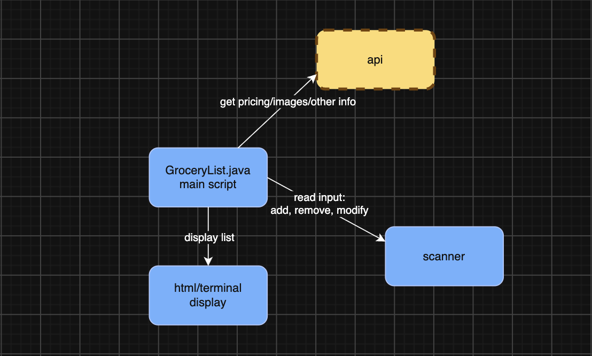

# Grocery List Helper

Tool that will help with grocery list organization by adding, removing, modifying, and updating items in the list.

## The Problem

Next year I'll be living in an apartment, so I want to make a grocery list that'll let me add, remove, and mark items. Grocery shopping completely on my own will be something new for me, so I want to make something that will make it simpler, easy to look at and keep track of, and reusable for the future.

## How It Works

- Program will take user input to either add, remove, or modify a grocery item from a list
- Will display the list to the user
- Will get information such as prices or alternatives from an api



## Tech Stack

- **Language:** Java / html / css / JavaScript
- **Libraries:** none
- **External tools:** APIs

## Setup

Step-by-step: how does someone who just cloned your repo get it
running?

```bash
git clone https://github.com/tjoshi345/grocerylist
cd grocerylist
```

## Usage

How to actually run the thing, with examples.

```bash
node GroceryListHelper.js
```

## Roadmap

Do
- [ ] add items
- [ ] remove items
- [ ] modify items
- [ ] mark items
- [ ] save items for next list

Schedule
- [ ] get pricing information through api
- [ ] calculate total costs
- [ ] make a nice display
- [ ] calculate average costs per week
- [ ] show most expensive items

Delegate
- [ ] show list with a calendar
- [ ] organize list by category

Delete
- [ ] make shareable with other people
- [ ] allow others to edit
- [ ] summary of popular items bought, how money was spent, etc.
- [ ] find alternatives for a better price

## Author

Twisha Joshi, [GitHub](https://github.com/tjoshi345)
